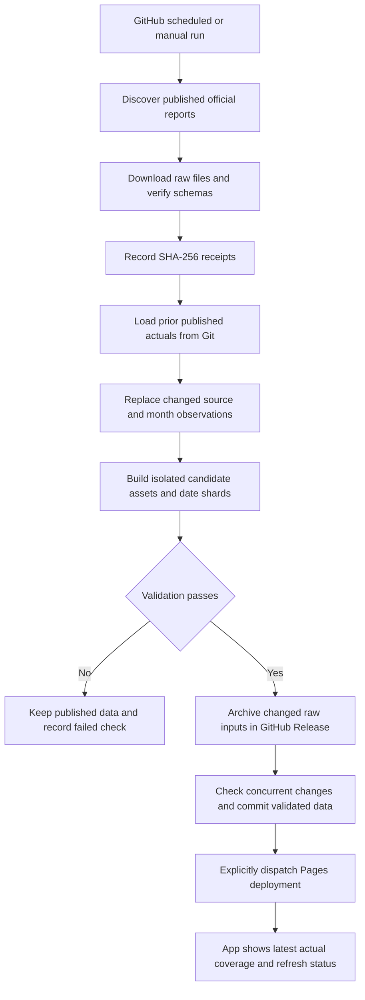

# Official-data ELT pipeline

## Objective and publication boundary

The app updates from official public data without the analyst forecast workbook. A scheduled check discovers available reports, extracts their exact published bytes, loads a raw cache and ingestion receipts, transforms the observations into a complete candidate app bundle, and validates that bundle before publication. New reporting periods and corrections to prior observations use the same process.

The personal analyst workbook is neither opened nor deleted. Workbook-derived production rows and forecasts are removed from the published dataset. Official agencies' XLS/XLSX reports remain legitimate source formats: the distinction is their provenance, not their file extension. AER's publicly linked annual history starts in 2017; unavailable 2015-2016 AER history and unsupported Saskatchewan upgrader forecasts are not carried forward as actuals.



The public boundary is the data commit followed by the Pages deployment. Intermediate downloads and partially written candidates are not served. A failed required production input, failed AER infrastructure build, unexpected source schema, failed validation, missing raw archive, or conflicting concurrent data change prevents that candidate's data publication. An unavailable optional market-access, railway, or reference refresh can preserve its prior layer while other validated changes publish with a warning. A failure-status update may still be published so the interface can explain why the prior dataset remains in use.

## Cadence and source contracts

| Family | Polling schedule | Discovery and refresh policy |
| --- | --- | --- |
| Production | Daily 07:17 UTC | Current/bulk source files and the latest three published monthly reports; no assumed publication based on today's date |
| Historical production revisions | Sunday 07:17 UTC run | Recheck annual AER files and historical publication revision tokens; download changed files beyond the normal window |
| AER feeder pipelines and installations | Sunday 08:37 UTC | Import the official SHP/CSV ZIP archives; validate and publish the complete geometry, category, tile, and index family together; any family failure blocks the candidate |
| Market-access pipelines and railways | Sunday 08:37 UTC | Refresh service geometry and validate the candidate layer; an unavailable upstream refresh preserves its prior layer with a warning |
| Tariff/refinery source monitoring | Production and infrastructure runs | Detect source publication changes; import the separate EIA annual capacity observations; retain reviewed tariff/operator facts pending review |
| AESO | Existing 30-minute schedule | Independent snapshot and existing alert behavior |

Scheduled checks are polling, not publisher webhooks. A regulator's own reporting lag still applies. GitHub runs can be delayed or dropped under load, and schedules operate from the default branch. The app's checked-at time and per-source observation periods are therefore separate fields. [GitHub schedule documentation](https://docs.github.com/en/actions/reference/workflows-and-actions/events-that-trigger-workflows#schedule).

Supported production source groups are `aer`, `petrinex-ab`, `petrinex-sk`, `bcer`, `ndic`, `manitoba`, and `montana`. [Official source discovery](OFFICIAL_SOURCE_DISCOVERY.md) documents report formats and publication indexes; [reference-source automation](REFERENCE_SOURCE_AUTOMATION.md) documents independent EIA observations and review limits. The initial regional normalized history is retained from the audited Git baseline, while AER annual history is replaced with direct official publications. The first live monthly-catalog observation records historical publisher revision tokens without downloading all historical files. Later revision-token changes trigger historical downloads. An observed catalog token is not represented as a raw-byte receipt; files receive SHA-256 receipts only when their bytes are actually fetched or verified. This reduces repeated historical downloads while preserving the adopted, audited Git history.

ST53 rates are m³/day; ST39, Petrinex, BCER, and Manitoba fluid volumes are monthly m³; NDIC and Montana volumes are monthly barrels. Conversions use calendar month lengths, including leap years. Actual-only ingestion never fills a missing month with a forecast. Reported zero observations are kept where the source contract distinguishes them from unpublished template cells.

The weekly AER importer, `scripts/build_aer_infrastructure.py`, reads the official [pipeline archive](https://www.aer.ca/data/pipeline/Pipelines_SHP.zip) and [installation archive](https://www.aer.ca/data/pipeline/Pipeline_Installations_SHP.zip). Each contains a shapefile and accompanying CSV. Mapped record identities, status and substance counts must reconcile before transformation from the declared NAD83 coordinates to WGS84. Source rows without mapped geometry are counted explicitly rather than given invented coordinates.

The feeder layer retains the existing Operating/Permitted filters for Oil-Well Effluent, Crude Oil, HVP Products, LVP Products, Condensate, and Hydrocarbon Diluents. The installation file retains mapped installations; its pump, compressor, terminal, and meter menus include Operating, Permitted, and Suspended installations. This is a defined map scope, not an exhaustive inventory of every pipeline type. Tiles cover each line part's bounding box, including tiles crossed between vertices, and retain the complete feature geometry.

The September 2026 local audit produced 32,409 feeder features, 4,445 mapped installations, and 261 category tiles. Fourteen very short, valid line parts retain their transformed coordinate precision because rounding would collapse them. These are audit snapshot counts, not fixed targets for future source releases.

## Data layout and replay

| Location | Purpose and retention |
| --- | --- |
| `data/raw/` | Download cache and successful source-index pages; ignored by Git and replaceable |
| Candidate work directory under `data/processed/` | Staged outputs, run logs, ingestion result, validation results, release summary |
| `public/data/manifest.json` | Published source coverage and source-file ingestion receipts |
| `public/data/monthly/` and matching assets/seasonality files | Durable normalized actual observations in Git |
| `public/data/aer_pipeline_index.json`, AER geometry files, `pipelines/`, and `pipeline_tiles/` | Matching AER source metadata, full layers, menu categories, and map tiles; released as one validated family |
| `public/data/elt_status.json` | Last refresh result and reporting coverage shown in the app |
| GitHub Release `elt-raw-RUN_ID-ATTEMPT` | ZIP packages of changed, successfully ingested raw source bytes, plus a checksummed source manifest |

The archive step accepts only raw paths contained in `data/raw/` whose bytes match successful ingestion receipts. It does not package the entire workspace, the personal workbook, source books, credentials, or arbitrary cache files. Changed official production inputs, AER pipeline and installation SHP/CSV ZIP archives, and imported EIA capacity reports are archived before the validated data commit. Market-access and railway geometry remain normalized Git snapshots; the release archive is not a complete archive of every external GIS response. A cached AER ZIP is still eligible for archival when its checksum differs from the published source receipt, even if the latest request returned unchanged content.

Reproducibility means checking out the recorded baseline commit, restoring the archived official inputs for that run, and using the recorded parser version and source selection to rebuild the next candidate. The Git baseline carries historical normalized observations; not every historical raw input predating this automation was archived. Deleting an Actions download cache does not delete the published history. Release packages provide durable source evidence beyond temporary workflow logs and caches.

## Validation, failure handling, and concurrency

The release checks include source signatures and schemas, valid dates and units, asset identities, coordinate bounds, compact shard references, record totals, source coverage, actual-only rules, duplicate observations, AER source reconciliation, and infrastructure geometry. Unsupported formats stop at the source boundary and require a parser change before use. Production ingestion reuses validated observations when their source bytes are unchanged.

Monthly updates replace whole source/month observations, including revised quantities and deleted source rows, rather than appending duplicates. All affected assets, monthly shards, manifest, geometry, and seasonality are staged and released together because monthly integer references depend on the matching asset table.

The AER infrastructure builder validates matching features and properties across full layers, menu categories, tiles, and their index. It stages the complete family and installs the index last. Any AER download, transformation, validation, or installation failure rejects the whole infrastructure candidate, including otherwise successful optional refreshes. A partially updated index/category/tile combination cannot become the published app bundle.

The publication helper stages only explicitly listed generated files. It fetches current `main` before pushing and allows unrelated AESO changes to remain in place. Overlapping candidate data or parser changes require a fresh run from `main`; the job does not force-push over them. Same-family workflow concurrency also prevents competing refreshes from publishing overlapping candidates.

The existing AESO alert job and recipients are unchanged. The production and infrastructure pipelines do not invoke alert delivery.

## GitHub requirements

GitHub Actions runs the jobs; GitHub Releases stores new raw-input packages; GitHub Pages hosts the validated app. The workflows use the repository's built-in `GITHUB_TOKEN` with the permissions needed to commit data, create the source archive release, and dispatch Pages. No additional production-data API key, personal access token, database server, cloud account, or scheduler is required.

The workflow explicitly dispatches `deploy-pages.yml` after a bot data push because a push authenticated with `GITHUB_TOKEN` does not normally trigger another workflow's push event. [GitHub workflow-trigger documentation](https://docs.github.com/en/actions/how-tos/write-workflows/choose-when-workflows-run/trigger-a-workflow#triggering-a-workflow-from-a-workflow).

Actions must remain enabled, repository rules must permit the workflow's data commits, and the private repository needs sufficient Actions allowance or an appropriate spending limit. Runtime, cache, and artifact usage depend on source sizes and refresh history; no fixed cost estimate is assumed. [GitHub Actions billing](https://docs.github.com/en/billing/concepts/product-billing/github-actions).

Data-only updates preserve the encrypted entry page and existing password, so this pipeline does not require a new encryption secret. Application HTML edits still use the documented protected-wrapper build. Raw source archives stay in repository Releases, not in the Pages deployment artifact.

## Operation and recovery

Use **Run workflow** in GitHub Actions to request a check before the next scheduled run. Inspect the summary and source checks when a run fails. An unpublished month is a reporting-lag observation, whereas a failed request for an already published report is an ingestion failure. Do not erase the baseline or insert zero production to make a failing source pass.

For local inspection, create a new work directory and run:

```powershell
python scripts/elt_pipeline.py --mode production --work-dir data/processed/review-001
```

This builds and validates a candidate without committing or pushing. An offline source-specific replay uses the cached official publications:

```powershell
python scripts/elt_pipeline.py --mode production --sources aer --offline --skip-references --work-dir data/processed/review-002
```

For a deliberate historical import, call the lower-level importer with an isolated output path and explicit start date:

```powershell
python scripts/run_etl.py --sources aer --download --history-start 2017-01 --output-dir data/processed/aer-review --result-json data/processed/aer-review-result.json
```

Local requirements are Python 3.12+ and R; the workflow uses R 4.5.2. Install the same pinned Python packages and AER report reader as the workflow:

```powershell
python -m pip install -r scripts/requirements-elt.txt
Rscript scripts/install_elt_r.R
```

The Python requirements pin `openpyxl` 3.1.5, `pyshp` 2.3.1, and `pyproj` 3.7.2. The R installer pins `readxl` 1.4.5 and installs its supporting packages. The GitHub workflow provisions its runtime and build dependencies. `--promote` copies validated results into the local checkout for review; the GitHub workflow remains the normal archive-and-publication path.

For a source format change, add a representative synthetic regression fixture and update the parser, then rerun from current `main`. For a tariff/operator publication change, review and update the documented fact snapshot before clearing its review state. If a deployed release must be rolled back, restore its complete prior data bundle and deploy that Git commit. Keep asset tables with their matching monthly shards, and AER indexes with their matching category and tile files.
